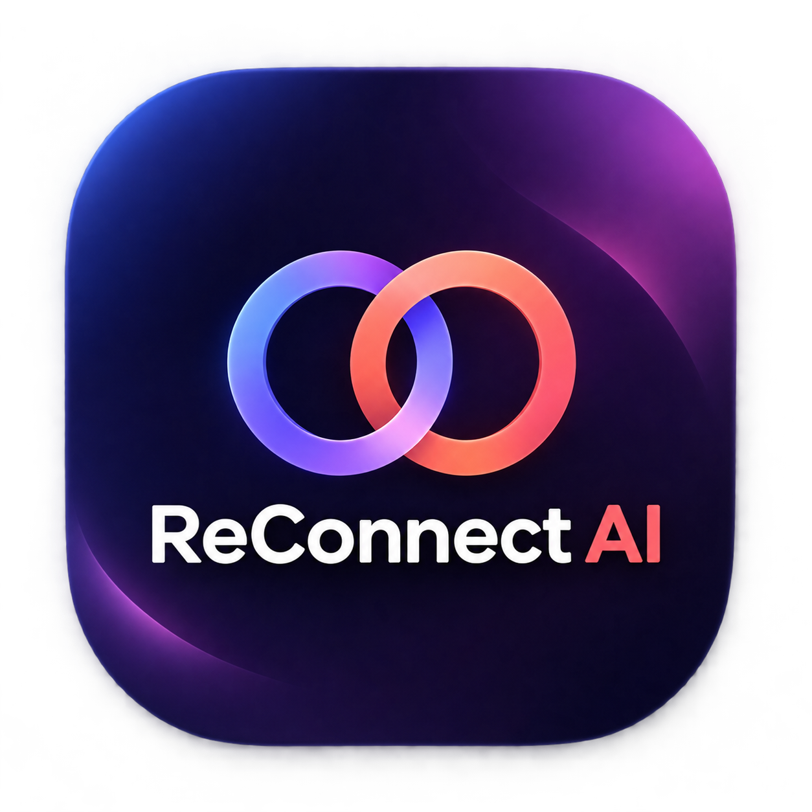
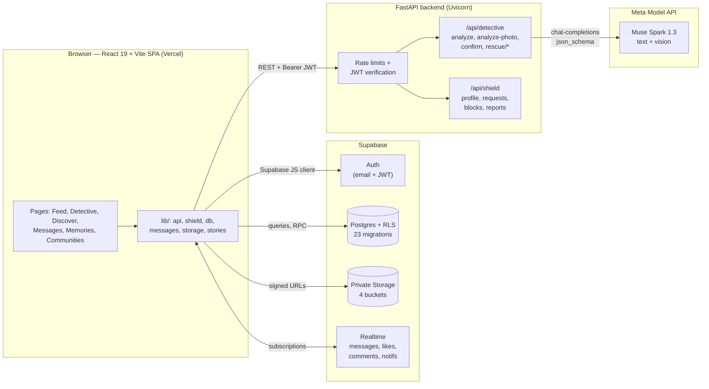

<div align="center">



# ReConnect AI

### Rediscover Memories. Reconnect Lives.

An AI-powered social reconnection platform that helps people rediscover
childhood friends, former classmates, and lost acquaintances through old
photographs, shared memories, contextual clues, and consent-based connections.

<p>
  <a href="https://thereconnect-ai.vercel.app/"></a>
  <a href="https://github.com/Davozay/ReconnectAI"></a>
</p>

<p>
  
  
  
  
  
  
  
  
  
</p>

**[Live Application](https://thereconnect-ai.vercel.app/)** ·
**[GitHub Repository](https://github.com/Davozay/ReconnectAI)** ·
**Demo Video** *(coming soon — placeholder for submission)*

</div>

---

## Contents

- [About ReConnect AI](#about-reconnect-ai)
- [The Problem](#the-problem)
- [Our Solution](#our-solution)
- [Key Features](#key-features)
- [How ReConnect AI Works](#how-reconnect-ai-works)
- [AI Integration and Technical Innovation](#ai-integration-and-technical-innovation)
- [Technology Stack](#technology-stack)
- [System Architecture](#system-architecture)
- [Screenshots and Demonstration](#screenshots-and-demonstration)
- [Getting Started](#getting-started)
- [Environment Variables](#environment-variables)
- [Privacy, Safety and Responsible AI](#privacy-safety-and-responsible-ai)
- [Challenges and Engineering Decisions](#challenges-and-engineering-decisions)
- [Future Improvements](#future-improvements)
- [Creator](#creator)
- [Acknowledgments](#acknowledgments)

---

## About ReConnect AI

ReConnect AI is a full-stack social platform built around one belief: **the
people who shaped our childhoods should not stay lost to time**. Users preserve
childhood memories as written stories and photographs, run AI-assisted analysis
on old photos to surface forgotten context (places, schools, nicknames, years),
and reconnect with the real people behind those memories — always through
explicit, consent-based connection requests.

Unlike conventional social networks that optimize for new content, ReConnect AI
optimizes for **recovery**: recovering names, places, and relationships from
fragmented memories, then turning them into genuine reconnections.

## The Problem

Most people lose touch with childhood friends, schoolmates, neighbors, and
mentors as life moves on:

- **Relocation** scatters families, schools, and neighborhoods across cities
  and countries.
- **Lost contact details** — changed numbers, abandoned emails, married names —
  make old friends unsearchable.
- **The passage of time** erodes exactly the details needed to find someone: a
  nickname, a school name, the year of a class photo.
- **Existing platforms** assume you already know who you are looking for. There
  is no mainstream tool for rediscovering someone from a fading photograph and
  half-remembered clues.

The result is millions of meaningful relationships that quietly expire — not
from conflict, but from missing information.

## Our Solution

ReConnect AI attacks the missing-information problem directly:

1. **Preserve** — users save memories as text stories and upload childhood
   photographs to private storage.
2. **Analyze** — the Memory Detective sends a photo (plus any typed context) to
   Meta's Muse Spark vision model, which reads visible text, scenes, and
   objects and returns structured clues: schools, nicknames, locations, years,
   events.
3. **Confirm** — users review and confirm each clue, keeping a human in the
   loop before anything is acted on.
4. **Discover** — confirmed clues power contextual discovery across an
   opt-in directory of discoverable members, alongside search and suggestions.
5. **Reconnect with consent** — every connection starts as a request the other
   person can accept or decline. Messaging unlocks only after acceptance.

Privacy is architectural, not cosmetic: buckets are private, signed URLs
expire, row-level security enforces ownership, and the AI is never asked to
identify anyone from facial characteristics.

## Key Features

Everything below is implemented and visible in the codebase. Anything still in
progress is labeled in [Future Improvements](#future-improvements).

| Feature | How it works |
|---|---|
| **Memory Detective (AI photo analysis)** | Upload a childhood photo with optional typed context. The FastAPI backend validates the file, sends it to the Muse Spark vision model, and returns structured clues (schools, nicknames, locations, years, events, visible text) plus a summary. Users confirm or edit each clue before saving the memory. Works signed-in or as a public demo. |
| **Memory Rescue** | When a photo yields too few clues, a deterministic question engine asks adaptive follow-ups (year → place → school → names → event → scene → details), skipping topics already covered. Each answer is converted into structured clues with AI assistance when configured, or taken directly when offline. |
| **Shared memories feed** | Home feed of community-shared memories with cursor-based infinite scroll, likes, threaded comments, saves, hashtag filtering, and photo attachments. Private memories never leave the owner's account. |
| **Trending memories** | Hashtags are extracted from shared memories and ranked over a rolling 7-day window, with a trending rail and per-tag filtered feeds. |
| **Authentication & profiles** | Supabase email/password auth with email confirmation and password reset. Profiles hold display name, bio, hometown, nickname, childhood schools and places, plus avatar and cover photos. |
| **Onboarding** | Guided first-run flow capturing the childhood context (schools, locations) that powers later discovery. |
| **Contextual discovery** | Searchable opt-in directory of discoverable members, suggested-people ranking, and affiliation-aware matching helpers. Users control discoverability from settings. |
| **Consent-based reconnection** | Connection requests with pending/accepted/declined states, block/unblock, and user/photo/message reporting with admin moderation. Nothing connects silently. |
| **Messaging** | Private 1:1 conversations that unlock only after a reconnection is accepted (enforced by a database RPC), plus group chats, reactions, message search, editing, deletion, read receipts, photo attachments, and live updates over Supabase Realtime. |
| **Stories** | 24-hour photo stories visible to accepted connections, with views and likes. Expiry is enforced in queries. |
| **Communities** | Topic/school-based groups users can create, join, and browse, with member lists and member memories. |
| **Image uploads & storage** | Private Supabase Storage buckets for profile, memory, chat, and story media. Display uses short-lived signed URLs; uploads are type- and size-validated on both client and server. |
| **Scam-safety warnings** | New-connection conversations are scanned with local heuristics (links, urgency, money requests) and surface warnings — fully on-device logic, no message content sent to AI. |
| **Notifications** | Realtime notifications for likes, comments, requests, and messages, with unread counts. |
| **Responsive dashboard** | Mobile-first React layout with a bottom nav / drawer, dark-mode-aware theming, and skeleton loading states. |

## How ReConnect AI Works

The core user journey, as implemented:

```
Create an account → Complete onboarding → Add a memory or photograph
  → AI analyzes the photo + context → Review & confirm the clues
    → Discover potential connections → Send a reconnection request
      → Reconnect with consent → Message & share memories
```

1. **Sign up & onboard** — register with email, confirm, then add childhood
   schools, places, and nickname.
2. **Preserve a memory** — write a story in the Home feed or Memories page, and
   optionally attach a photo.
3. **Run the Detective** — upload an old photo; Muse Spark returns clues and a
   summary. Low-clue photos trigger Memory Rescue questions.
4. **Confirm clues** — accept, edit, or reject each extracted detail. Confirmed
   clues are saved with the memory.
5. **Discover** — browse the discoverable directory, search, or follow
   suggestions to find the people behind the memories.
6. **Request & reconnect** — send a reconnection request; on acceptance,
   messaging unlocks and the friendship resumes.

## AI Integration and Technical Innovation

> The current integration uses **Meta's Muse Spark** model family through the
> **Meta Model API**. No other AI provider is integrated.

### Model & provider

- **Provider:** Meta Model API (`https://api.meta.ai/v1`), an
  OpenAI-compatible endpoint consumed with the `openai` Python SDK —
  see [`backend/app/services/meta_client.py`](backend/app/services/meta_client.py).
- **Models:** `META_MODEL_TEXT=muse-spark-1.3` for text tasks and
  `META_MODEL_VISION=muse-spark-1.3` for photo tasks, both configurable via
  environment variables.
- **Call shape:** chat-completions with `response_format: json_schema` for
  text, and OpenAI-style `image_url` data-URL content parts for vision, so
  every AI response arrives as validated, structured JSON.

### What the AI does

| Task | Endpoint | Input → Output |
|---|---|---|
| Photo clue extraction | `POST /api/detective/analyze-photo` | Childhood photo (+ optional memory text, nickname) → schools, nicknames, locations, years, events, visible text in photo, summary |
| Memory text extraction | `POST /api/detective/analyze` | Typed memory / nickname → same structured clue schema |
| Rescue-answer parsing | `POST /api/detective/rescue/answer` | One follow-up answer → typed clue items (falls back to direct capture when AI is unconfigured) |

### How results are processed

1. The backend validates uploads (JPEG/PNG/WebP/GIF, 8 MiB cap) before any AI
   call.
2. Model output is parsed as strict JSON against Pydantic schemas; malformed
   output surfaces as a clean API error, never as invented UI state.
3. The frontend presents every clue as a draft the user must **confirm or
   edit** — AI output is advisory until a human approves it.
4. Confirmed clues persist on the memory record and feed discovery.

### What the AI does NOT do

- **No facial recognition.** A hard-coded system instruction
  (`NO_FACE_IDENTITY`) forbids identifying, naming, or describing any real
  person from facial characteristics. No face templates are created or stored.
- **No biometric matching.** Person matching scores only user-confirmed
  context (school names, year ranges, locations, nicknames, keywords).
- **Memory Rescue questions are rule-based**, not AI-generated, so they work
  with no API key. Scam warnings are local heuristics, not model calls.

### Limitations (honest scope)

- AI features require a `META_MODEL_API_KEY`; without one the Detective runs
  in a clearly labeled simulated/demo mode.
- Live AI matching against the real member directory is the next milestone:
  `/matches` currently returns an empty set rather than invented people, and
  `/discover` ranks explicitly labeled fictional demo fixtures while real
  discovery runs on the Supabase directory.
- Photo analysis quality depends on image clarity and legible detail; the
  model reads what is visible, it does not guess identities.

## Technology Stack

| Layer | Technology | Purpose |
|---|---|---|
| Frontend | React 19 + TypeScript | App UI, routing (react-router-dom), animations (framer-motion), icons (lucide-react) |
| Build | Vite | Dev server, TypeScript build, production bundling |
| Backend | FastAPI (Python) + Uvicorn | REST API: Memory Detective + ReConnect Shield routes |
| Validation | Pydantic v2 | Request/response schemas, AI-output parsing |
| AI/ML | Meta Model API — Muse Spark 1.3 | Vision + text clue extraction via OpenAI-compatible SDK |
| Database | Supabase Postgres + RLS | Profiles, memories, photos metadata, social graph, messages; 23 SQL migrations |
| Auth | Supabase Auth | Email/password, sessions, JWTs; backend verifies via JWKS |
| Realtime | Supabase Realtime | Live messages, likes, comments, notifications |
| Storage | Supabase Storage (private) | `profile-photos`, `memory-photos`, `chat-attachments`, `story-media` buckets |
| Deployment | Vercel | Frontend hosting with SPA rewrites |
| Dev tools | ESLint, tsc, pytest | Lint, typecheck, and backend test suite |
| HTTP/Auth libs | httpx, PyJWT, cryptography | JWKS verification, signed flows |

## System Architecture



**Data-flow notes:** the browser talks to Supabase directly for all
user-data operations (RLS enforces ownership server-side); the FastAPI backend
handles AI analysis and Shield safety actions only, and the API key never
leaves the server.

## Screenshots and Demonstration

> Screenshots are being captured for the submission. The placeholders below
> will be replaced with real captures from the live app before final review —
> no image links point at files that do not exist yet.

| Landing page | Home feed & composer |
|---|---|
| *Screenshot placeholder* | *Screenshot placeholder* |

| Memory Detective (AI analysis) | Discover & reconnection |
|---|---|
| *Screenshot placeholder* | *Screenshot placeholder* |

**Demo video:** *placeholder — video URL to be added before submission.*

In the meantime, the fastest demo is the live app itself:
**[thereconnect-ai.vercel.app](https://thereconnect-ai.vercel.app/)** — the
Memory Detective runs a public demo without signing in.

## Getting Started

### Prerequisites

- **Node.js** (LTS) with npm — for the Vite + React frontend.
- **Python 3.10+** with pip — for the FastAPI backend.
- A free **Supabase** project (database, auth, storage, realtime).
- *(Optional, for live AI)* A **Meta Model API key** from the
  [Meta Developer Console](https://ai.developer.meta.com). Without it, the
  Detective runs in labeled demo mode.

### 1. Clone the repository

```sh
git clone https://github.com/Davozay/ReconnectAI.git
cd ReconnectAI
```

### 2. Set up the database

Apply the SQL migrations in [`supabase/migrations/`](supabase/migrations/)
(`0001`–`0023`, in order) to your Supabase project, then configure Auth —
full step-by-step instructions live in
[`SUPABASE_SETUP.md`](SUPABASE_SETUP.md).

### 3. Install & run the frontend

```sh
cd frontend
npm install
npm run dev
```

The app starts at `http://localhost:5173`. Production checks:

```sh
npm run lint    # ESLint
npm run build   # tsc + production build
```

### 4. Install & run the backend

```sh
cd backend
python -m venv venv && source venv/bin/activate
pip install -r requirements.txt
cp .env.example .env   # then fill in your own values (see below)
uvicorn main:app --reload
```

The API starts at `http://localhost:8000`. Run the backend test suite with:

```sh
python -m pytest -q
```

### 5. Wire them together

Set `VITE_API_URL=http://localhost:8000` in `frontend/.env.local` and make
sure the backend's `CORS_ORIGINS` includes `http://localhost:5173`. Then
register at `/signup`, confirm via inbox, and log in.

## Environment Variables

Only variable **names** are documented here — always use your own credentials.
Never commit real secrets.

<details>
<summary><strong>Frontend</strong> — <code>frontend/.env.local</code> (gitignored)</summary>

```env
VITE_SUPABASE_URL=https://your-project.supabase.co
VITE_SUPABASE_PUBLISHABLE_KEY=paste-your-publishable-key-here
VITE_API_URL=http://localhost:8000
```

Find the Supabase values under **Project Settings → API** in your Supabase
dashboard. Only the publishable key belongs here — never the `service_role`
secret. `VITE_API_URL` points at the FastAPI backend.

</details>

<details>
<summary><strong>Backend</strong> — <code>backend/.env</code> (gitignored, see <code>backend/.env.example</code>)</summary>

```env
# Meta Model API (server-side only — never expose to the frontend)
META_MODEL_API_BASE=https://api.meta.ai/v1
META_MODEL_API_KEY=paste-your-meta-api-key-here
META_MODEL_TEXT=muse-spark-1.3
META_MODEL_VISION=muse-spark-1.3
META_MODEL_TIMEOUT=30
DETECTIVE_MAX_PHOTO_BYTES=8388608

# Supabase JWT verification for Shield routes
SUPABASE_URL=https://your-project.supabase.co
SUPABASE_JWKS_URL=
SUPABASE_JWT_SECRET=
SUPABASE_JWT_ISSUER=
SUPABASE_JWT_AUDIENCE=
SHIELD_DEMO_MODE=false
SHIELD_ADMIN_IDS=
CORS_ORIGINS=http://localhost:5173

# Shield rate limits (sliding windows)
SHIELD_REQUESTS_PER_DAY=10
SHIELD_MESSAGES_PER_HOUR=30
SHIELD_REPORTS_PER_DAY=5
SHIELD_PHOTOS_PER_DAY=20
SHIELD_DISCOVER_PER_HOUR=60
SHIELD_SCAMCHECK_PER_HOUR=60
```

Get `META_MODEL_API_KEY` from the Meta Model API dashboard
([ai.developer.meta.com](https://ai.developer.meta.com)). `SUPABASE_URL` alone
is enough for JWT verification — keys are fetched from your project's JWKS
endpoint. `SHIELD_DEMO_MODE=true` is a hackathon-only fallback when Supabase
is unset.

</details>

## Privacy, Safety and Responsible AI

Implemented protections (all verifiable in the codebase):

- **Private-by-default storage** — all four buckets are private; images load
  only through short-lived signed URLs, and RLS policies restrict reads to
  owners plus viewers of explicitly shared memories.
- **Per-memory sharing control** — every memory is private unless the user
  toggles sharing; feed queries return shared rows only.
- **Consent-based connections** — requests, acceptance, blocking, and
  reporting are first-class; messaging requires an accepted reconnection.
- **No facial recognition, ever** — the AI system prompt forbids identifying
  anyone from faces; no biometric data is created, matched, or stored.
- **EXIF stripping** — JPEG metadata (location, device) is removed from
  Shield photo uploads server-side.
- **Human-in-the-loop AI** — model output is always a user-confirmed draft;
  nothing is published or matched automatically.
- **Credential hygiene** — the Meta API key lives only on the server;
  Supabase JWTs are verified via JWKS with issuer/audience/expiry checks.
- **Abuse throttles** — per-user sliding-window rate limits on requests,
  messages, reports, photos, discovery, and scam checks.

No claims are made about encryption certifications, compliance audits, or
biometric processing — none exist in this project.

## Challenges and Engineering Decisions

- **Judging without keys** — hackathon reviewers may not have a Meta API key,
  so the Detective degrades to a clearly labeled simulated mode instead of
  breaking. Every demo fixture is explicitly tagged as fictional.
- **Honest empty states over fake people** — until live AI matching against
  the real directory lands, `/matches` returns zero matches rather than
  inventing candidates. Trust beats a flashy demo.
- **Security in the database, not the client** — RLS policies and RPCs (e.g.
  conversation creation requires an accepted reconnection) mean a compromised
  frontend cannot leak private rows.
- **Ephemeral media URLs** — 60-second signed URLs keep shared links from
  becoming permanent; components resolve them lazily per post.
- **Feed performance** — cursor-based pagination, back-navigation caching with
  scroll restoration, and lazy per-card photo resolution keep the Home feed
  fast as it grows.
- **Deterministic fallbacks for AI paths** — rescue questions and scam checks
  run without any model, so core safety and discovery flows never depend on an
  external API being up.

## Future Improvements

Planned — **not yet implemented**:

- Live AI matching of confirmed clues against the real member directory
  (replacing the labeled demo fixtures in `/discover`).
- Persistent Shield store (currently in-memory; resets on backend restart).
- Hosted backend deployment configuration (Docker / managed Python host).
- Push notifications and email digests for reconnection activity.
- Multi-photo memory posts and richer story effects.
- Expanded moderation tooling and community analytics.
- Additional auth providers (OAuth) alongside email/password.

## Creator

<div align="center">

**Dave Ozay**

*Software Developer | AI Enthusiast | Creative Technologist*

Builder of ReConnect AI — designed and engineered end to end, from the
Meta-powered Memory Detective to the Supabase-backed social platform.

</div>

## Acknowledgments

- [Meta](https://ai.developer.meta.com) — Muse Spark models via the Meta
  Model API powering photo and memory analysis.
- [Supabase](https://supabase.com) — Postgres, Auth, Storage, and Realtime
  backbone.
- [FastAPI](https://fastapi.tiangolo.com), [React](https://react.dev),
  [Vite](https://vite.dev) — the application frameworks.
- [Vercel](https://vercel.com) — frontend hosting.
- The open-source maintainers behind Pydantic, the OpenAI Python SDK,
  react-router, Framer Motion, and Lucide icons.

*No license file is present in the repository yet — one will be added before
final submission.*

---

<div align="center">

**ReConnect AI — Rediscover Memories. Reconnect Lives.**

[Live App](https://thereconnect-ai.vercel.app/) ·
[Repository](https://github.com/Davozay/ReconnectAI)

</div>
